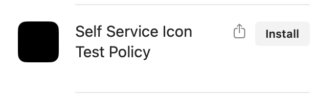
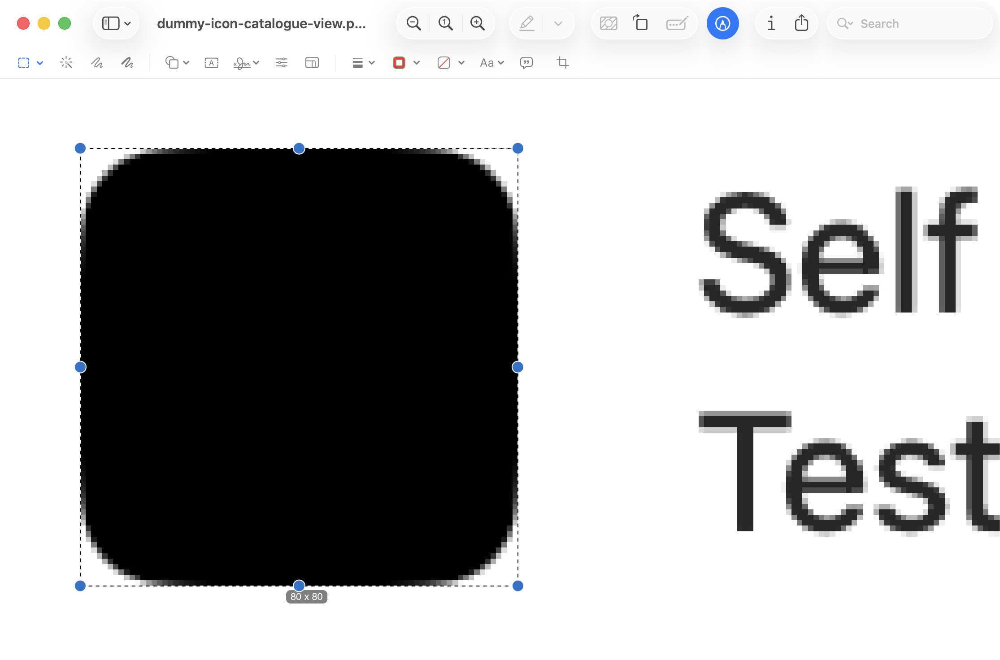
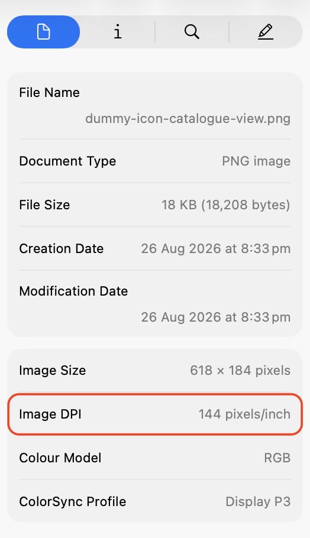

# Submit An MDM Icon Size

Measure how large a self service app draws its icons.
Send the size so Mica can add it to the **Preview Size** menu.

Do this in a test environment.
If you have no test environment, scope the item to your own Mac or a test device.

## Measure the icon

1. Create a test item in your MDM's self service app, or duplicate an item whose icon you can change.
2. Set the item's icon to an image with colour from edge to edge.
   Do not use an app icon with transparent padding.
   The repo has images for this in [extras/dummy-images](https://github.com/lukecharters/Mica/tree/main/extras/dummy-images).
3. Open the self service app and take a screenshot of the item with ⇧⌘4.
   The edges of the screenshot do not need to be exact.
   If the app shows icons at more than one size, capture each size and repeat steps 4 and 5 for each.

4. Open the screenshot in Preview.
   Drag a selection around the icon to its exact edges.
   Zoom in if you need to.
   Note the size that Preview shows for the selection.

5. In Preview, open the inspector with ⌘I.
   Note the **Image DPI**.

## Send the size

[Open an issue](https://github.com/lukecharters/Mica/issues), or post in the `#mica` channel on the Mac Admins Slack.
Include these details:

- MDM vendor
- Self service app name
- The section that shows the icon. Write "All" if the app uses one size.
- Icon size in pixels
- Image DPI

## Examples

| MDM | Self service app | Section | Size (px) | DPI | Size (pt) |
|---|---|---|---:|---:|---:|
| Jamf | Self Service+ | Catalog View | 80 | 144 | 40 |
| Iru | Self Service | All | 164 | 144 | 82 |

At 144 DPI, one point is two pixels.
