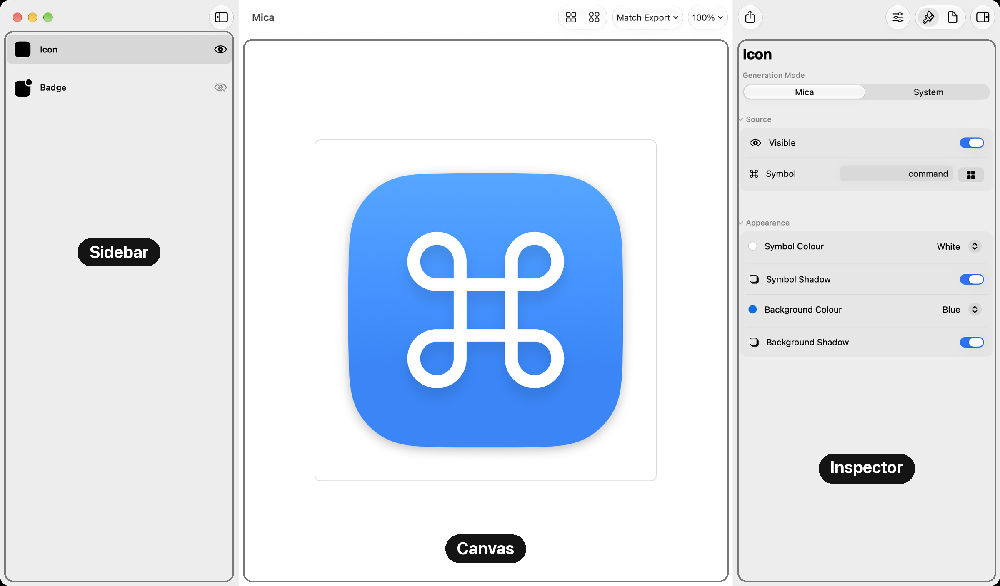
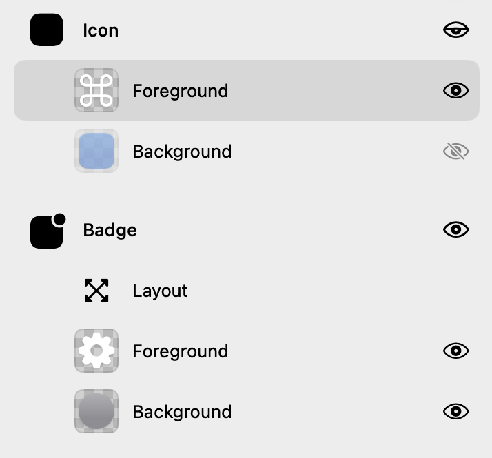
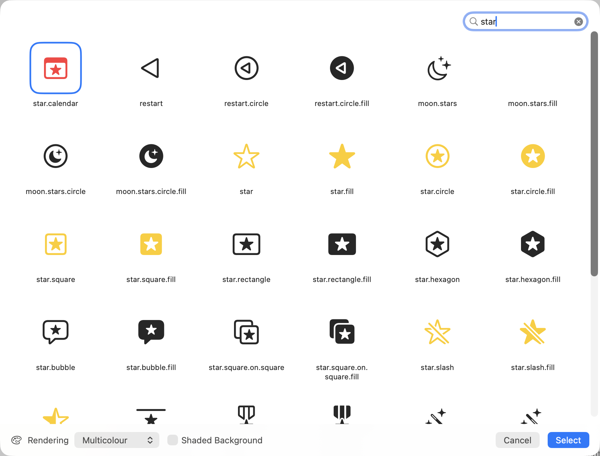

# The Mica Window
The Mica window has three panes for selecting, viewing, and changing an icon.

## Panes
| Pane | Purpose |
|---|---|
| Sidebar | Selects the Icon or Badge group and its layers. |
| Canvas | Shows the current icon and accepts direct actions. |
| Inspector | Changes the selected group or layer. |

Use **View ▸ Show Sidebar** or **⌃⌘S** to show the sidebar.
Use **View ▸ Show Inspector** or **⌃⌘I** to show the inspector.
Use **View ▸ Show Presets** or **⌃⌘P** to open the Presets window.
Use **View ▸ Preview Size** to change the preview size from the menu bar.
Use **View ▸ Show Advanced Controls** to show or hide advanced controls.

Presets are not a pane. Two toolbar buttons open them in a popover.
The [Presets window](#presets-window) shows them all. See [Use Presets](Use-Presets).

## Sidebar
The sidebar contains the Icon and Badge groups.
Advanced controls add Foreground and Background rows.
The Badge group also has a Layout row.
Each layer row shows a small picture of that layer.
A hidden layer's picture is dimmed.

Select a row to show its controls.
Each eye shows or hides that layer.
A mixed group eye means one layer is hidden.
The Layout row has no eye because it is not a layer.

The icon background is hidden here, so the Icon eye is mixed.

## Toolbar
| Control | Purpose |
|---|---|
| Icon Presets and Badge Presets | Open the presets for that part of the icon. |
| Preview Size | Sets the size the canvas draws the icon at. The default is **Match Export Size**. See [Preview sizes](#preview-sizes). |
| Zoom | Changes the canvas zoom. Lists nine steps from 25% to 800%. |
| Export | Saves the icon as a PNG. Same as ⇧⌘E. Sits above the inspector's left edge. |
| Sliders button | Shows or hides advanced controls. |
| Format and Document | Selects the inspector tab. |
| Inspector button | Shows or hides the inspector. |

The last four buttons sit above the inspector. When the inspector is too narrow for all of them, the extra ones move to a » menu. Widen the inspector to bring them back.

Right-click the toolbar to show or hide the text under each button.
The same menu has Customise Toolbar…, which lets you remove, add and reorder buttons.
Mica remembers both choices across launches.

Preview size and zoom do not change the exported PNG.

A pinch or a ⌘ scroll can set any zoom between 25% and 800%.
The menu then shows that value with no step ticked.
⌘+ and ⌘− still move to the next step up or down.

Both gestures zoom into the point under the pointer.
Put the pointer on the part of the icon you want to inspect.

### Preview sizes
The **Preview Size** menu starts with **Match Export Size**, the default.
Next come seven standard sizes, from 16 to 1024 points.
Then it lists the sizes that MDM portals show icons at, grouped by vendor.

| Vendor | View | Size (pt) |
|---|---|---:|
| Fleet Desktop | Software View | 24 |
| Fleet Desktop | Updates View | 64 |
| Intune Company Portal | List View | 30 |
| Intune Company Portal | Grid View | 80 |
| Intune Company Portal | Item View | 163 |
| Iru Self Service | All Views | 82 |
| Jamf Self Service+ | Catalog View | 40 |
| Jamf Self Service+ | Item View | 88 |
| Jamf Self Service classic | Browse View | 75 |
| Jamf Self Service classic | Item View | 120 |
| Munki Managed Software Center | Updates View | 64 |
| Munki Managed Software Center | Categories View | 75 |
| Munki Managed Software Center | Software View | 90 |
| Munki Managed Software Center | Item View | 140 |

Some rows share a size. Pick one, and every row with that size is ticked.

## Symbol browser
Click the grid button beside a Symbol field to open the symbol browser.
Type in Search to filter the grid.
Search also finds a symbol by its older names.
The grid shows only the symbols this Mac can draw.
Each symbol appears under the name that works on this Mac.
Use the Rendering menu to change how the grid draws each symbol.
Tick Shaded Background to draw the symbols on a shaded fill.
White and light symbols are hard to see without it, especially in Multicolor.
Both settings change the grid only.
They do not change your icon.
Use the arrow keys to move the highlight.
Press Return to select the highlighted symbol.
Press Escape with an empty search to close the browser.

## Canvas actions
| Action | Result |
|---|---|
| Click a visible layer | Selects that layer. |
| Drag the badge | Changes its offset. |
| Press an arrow key | Nudges the badge by one percent. |
| Drop an image on a layer | Imports the image into that layer. |
| Right-click | Opens the canvas menu. See [Right-click menus](#right-click-menus). |
| Pinch on a trackpad | Zooms the canvas. |
| Hold ⌘ and scroll | Zooms the canvas. |
| Scroll | Moves the canvas when the icon is larger than the pane. |

While you drag an image over the canvas, an outline shows the layer that will receive it.
You can also drop an image on a layer in the sidebar.
A drop on Icon or Badge in the sidebar imports that group's background.
Hidden layers do not accept drops.
With Advanced Controls off, a drop always imports the background.
No outline appears.
An icon in System mode does not accept image drops.
A badge in System mode accepts a drop on its background.

Both zoom gestures work in Mica mode and System mode.
The pointer must be over the canvas.

## Right-click menus
Right-click the canvas or a sidebar row to open a menu for that group.
Sidebar rows have the same kind of menu, with fewer items.

| Item | Canvas | Sidebar row |
|---|---|---|
| Copy Icon | Yes | No |
| Export as PNG… | Yes | No |
| Paste as Background, Paste as Symbol | Mica mode only | No |
| Remove Imported Background or Symbol | After you import an image | After you import an image |
| Reset Badge Position | After you move the badge | No |
| Hide Layers or Show Layers | Yes | Yes |
| Reset Icon or Reset Badge | No | Yes |

Each item names its group, such as **Paste as Badge Background**.

## Import notice
A notice appears at the top of the canvas after you import a background image.
It lists the settings the import changed, such as Shadow off or Foreground hidden.
Click the round arrow button to put those settings back.
The imported image stays.
The notice closes after eight seconds.
It stays open while the pointer is over it.
[Background Type](Icon-Settings#background-type) lists the import defaults.

## Exporting a PNG
Press ⇧⌘E, click **Export** in the toolbar, or click **Export** in the Document tab.
The Save panel opens with the size and colour space at the bottom.
Change them there to export one file at different settings.
The window's own settings do not change.

## Help menu
| Menu item | Opens |
|---|---|
| Mica Help | The [Home](Home) page of this wiki |
| Settings Index | [Settings Index](Settings-Index) |
| Command Line Tool Reference | [CLI Reference](CLI-Reference) |
| Release Notes | The Mica releases page |
| Report an Issue… | A new issue form, with your Mica and macOS versions filled in |

## Developer menu
Mica includes the tools used to build it. They are hidden by default.

Turn them on in **Settings ▸ Developer**. A **Developer** menu appears in the menu bar.
You do not need these tools to make icons. They are not supported.

| Menu item | What it does |
|---|---|
| Symbol Calibration | Fits and reviews how each SF Symbol is sized. |
| Reference Comparison | Compares a Mica icon against a reference image. |
| Export Shadow Variations… | Saves a set of icons with different shadows. |

Edits in Symbol Calibration do not change your icons.
Click **Adopt Fitted Set** to use them in every icon you make.
Click **Restore Bundled Calibration** in that window to undo this.
Mica reads symbol sizing once when it starts. Quit and reopen Mica to apply it.

None of these items has a keyboard shortcut.

## Keyboard shortcuts
| Shortcut | Action |
|---|---|
| ⇧⌘E | Export as PNG |
| ⌘S | Export Configuration |
| ⌘O | Import Configuration |
| ⇧⌘C | Copy Icon |
| ⌘C | Copy the focused canvas icon or selected text |
| ⌘V | Paste an image as the icon background |
| ⌃⌘S | Show or hide the sidebar |
| ⌃⌘I | Show or hide the inspector |
| ⌃⌘P | Open the Presets window |
| ⌘+ / ⌘− / ⌘0 | Zoom in, zoom out, or use actual size |
| ⌘, | Open Settings |

The four **Paste as** and four **Import as** commands have no shortcuts.
